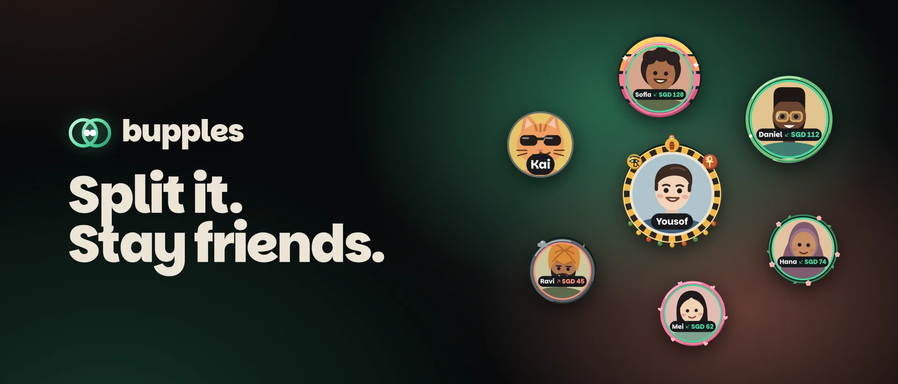
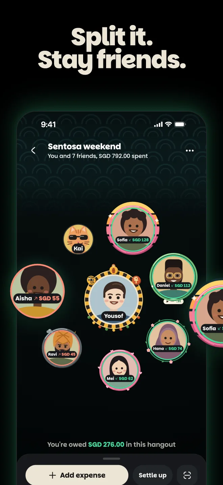
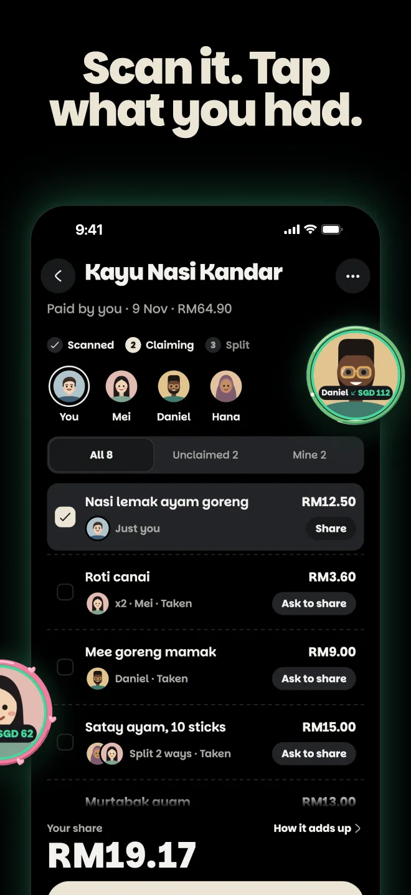
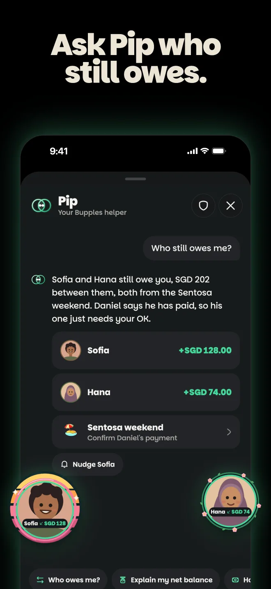

# Bupples

**Shared expenses. Clear balances. More time with your people.**

Bupples helps friends split dinners, trips and everyday costs. Create a hangout or a standalone split, scan a receipt, choose who had each item, and keep track of what remains to settle.

[App Store](https://apps.apple.com/my/app/bupples/id6777620291) · [Google Play](https://play.google.com/store/apps/details?id=com.bupples.bupples) · [Product site](https://bupples.web.app) · [Engineering case study](https://yousofselim.com/work/bupples/)

**Live on iOS and Android.** Version 1.5.0, a full redesign, has been live on the App Store and Google Play since 11 November 2026. This is the public product and engineering showcase. Application source is private.

  

  
  
  
  

Store screenshots for 1.5.0, captured from the app with a demo account and illustrated cast. [All seven](media/store-1.5/).

## What the product brings together

- **Shared expenses:** hangouts, standalone splits, receipt review and item-level claiming.
- **Clear settle-up plans:** cent-exact arithmetic, separate currency ledgers and server-checked settlements.
- **Private flows:** participant-scoped expenses and splits, with access enforced at the backend.
- **Personal expression:** custom profiles, accent colours and Pip Pro features, while financial colours keep their meaning.
- **Native integration:** iOS WidgetKit / SwiftUI and Android RemoteViews alongside the Flutter app.
- **Finality you can trust (1.5):** five minutes after an expense or settlement is recorded, the server locks it, so nobody can quietly cancel, reject or delete a receipt later. Forgiving a debt stays open.
- **Pip, the in-app guide (1.5):** answers questions about your balances and replies with cards that open the exact screen you need.

## My contribution

I’m **Yousof Selim**, Bupples’ founder and sole developer. I own the product design, Flutter client, Firebase backend, security rules, native widgets, tests and store releases.

The central engineering challenge is trust: every split must preserve the total, retries must avoid duplicate money records, and private expenses must stay with their participants.

| Layer | Implementation |
| :--- | :--- |
| App | Flutter, Dart and Riverpod |
| Backend | Firestore, Firebase Auth, Storage and TypeScript Cloud Functions |
| Receipt processing | On-device text recognition and Gemini-assisted extraction, followed by user review |
| Native widgets | Swift / SwiftUI / WidgetKit and Kotlin / RemoteViews |
| Subscriptions | RevenueCat with server-checked entitlements |
| Release operations | Remote Config, Crashlytics, automated checks and store delivery |

## Release evidence

The [case study](https://yousofselim.com/work/bupples/) connects product decisions to implementation and dated release verification. Its 5 September 2026 snapshot for build 184 records **6,048 Flutter tests** and **91 native fixtures** for the verified build. These are development checks for that snapshot, not adoption metrics or a claim about every later build.

For current platform availability, use the store links above. The product website provides the landing page and supported browser claim flows.

## Engineering reading

- [Current case study: money, privacy, receipts and release](https://yousofselim.com/work/bupples/)
- [Architecture snapshot — build 1.1.0+112](docs/ARCHITECTURE.md)
- [Receipt splitting](docs/receipt-splitting.md)
- [Privacy and deletion](docs/privacy-and-deletion.md)
- [Release history](CHANGELOG.md)

The repository’s detailed engineering notes retain their documented build context. Earlier device captures from September 2026 remain in [`media/current/`](media/current/).

[More work by Yousof](https://yousofselim.com) · [Discuss a project](mailto:yousofselim2@gmail.com)
